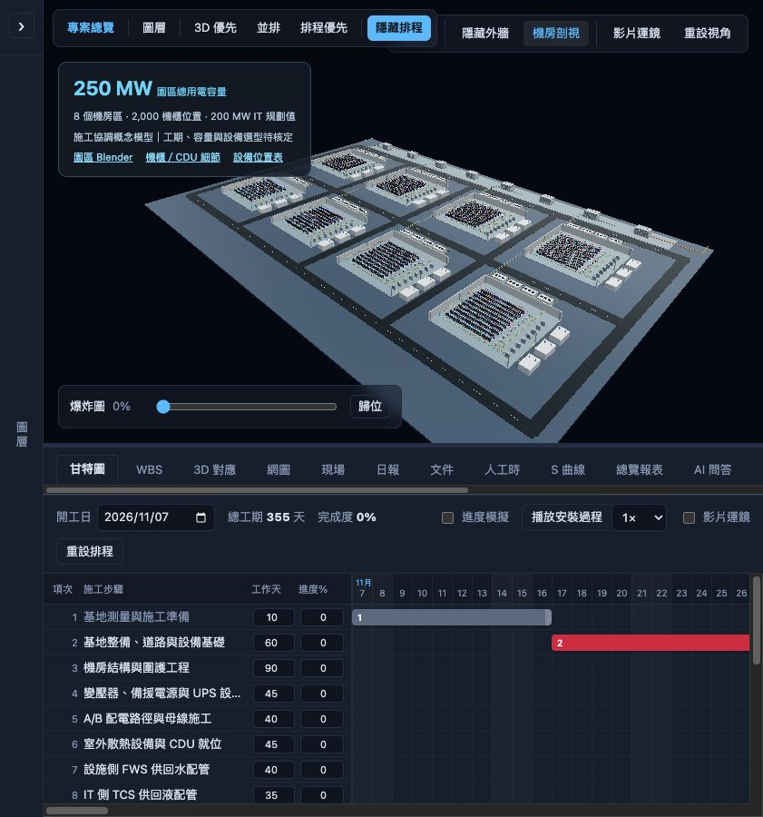

# PacificPower — 50 MW 資料中心施工數位孿生原型

以 [onework-io/Ampower](https://github.com/onework-io/Ampower) 的 Vue 3 / Three.js 施工管理程式為基礎，來源版本 `89d902e8e247cf29eb2d6b3eb0b4ca0b014f6062`。此 repo 獨立開發；不會推送到 Ampower，也不使用其部署目的地或資料庫設定。

## 現行容量基準（2026-11-07 更新）

使用者已將園區總用電容量由 250 MW 改為 **50 MW**。介面與專案清冊採新容量，原 200 MW IT／每櫃 100 kW 假設撤下；設備位置表的 `planningITkW` 改為 `null`（待核定）。既有 8 區、2,000 個機櫃位置僅保留為示意幾何，尚未依 50 MW 重新設計，不代表核定設備數量。
內部專案／模型識別碼及舊 Blender 檔名保留，以維持協作資料與引用；下載入口明示既有模型容量待重配。下文涉及 250 MW 或 200 MW 的模型產製紀錄屬歷史假設，不是現行容量基準。
驗證：330 項測試與建置通過；瀏覽器確認首頁、工作區與頁籤標題皆顯示 50 MW。

## 啟動

```sh
cd app
npm ci
npm run dev
```

首頁選擇「50 MW 資料中心建設」，進入 3D／排程工作區。可旋轉縮放、顯示／隔離施工分組、切換外牆、以 WBS 工項聚焦模型、播放甘特施工順序及建立現場標記。保留原有日報、成本、S 曲線及版本管理介面。

## 本版資料

- **250 MW 是園區總用電容量**。採用 1.25 的概念規劃比率，拆成 200 MW IT 與 50 MW 非 IT 用電預算；不是經驗證的尖峰容量計算。
- 8 個機房區 × 250 個機櫃位置 × 假設平均 100 kW = 200 MW IT。
- 17 個 GLB 施工分組，來源為本專案建立的 `Campus_250MW.blend`，公尺、Y-up 共用座標。
- 21 項資料中心 WBS 草案；工期、相依關係與 2026-11-07 開工日均為未核定範例。初始進度與預算為 0，基地與人員待指定。
- 網頁為效能將機櫃按機房區與材質合併。`models/assets.json` 保留 2,000 個機櫃 ID、分組及 Blender Z-up 原始座標；轉成網頁 Y-up 為 `[x,z,-y]`。目前點選／排程連動粒度為施工分組，尚非逐機櫃 BIM 查驗。
- `app/public/downloads/` 提供園區與機櫃／CDU 細節 `.blend`、容量假設及機櫃 CSV。
- `app/public/models` 是指向 `../../3D-datacenter` 的相對 symlink。

模型中的機電設備群為概念佔位，並非經核定的 250 MW 設備選型。尚未整合 IFC／Revit、真實軸網、碰撞檢查、現場掃描、工程查驗紀錄或即時感測資料；不能用作施工放樣或加工圖。照片助手不會從來源專案的示範照片捏造資料中心進度。

## 驗證

```sh
cd app
npm test
npm run build
```

GitHub Actions 僅執行測試與建置，**不會部署到 Ampower 的 Cloudflare / GitHub Pages**。PacificPower 的網站託管需另行設定。

## 後端與資料隔離

預設採本機 JSON / localStorage，storage keys 使用 PacificPower 命名。`server/` 保留來源 API 架構；如需多使用者、權限與資料持久化，請建立獨立 PacificPower Supabase／API 環境，再設定 `.env.example` 中的空白／占位參數。本次未連線或修改任何資料庫。

新模板 ID 為 `pacificpower-dc250-v1`，模板初始化腳本為 `server/scripts/seed-pacificpower-template.ts`。僅在自己的後端資料庫設定完成後手動執行。既有 `docs/` 的 Ampower 設計文件保留作來源架構參考，不能視為本資料中心的工程規格。

## 3D 來源與重建

`source-models/` 放置 Blender 建模與 GLB 匯出腳本。先執行園區建模腳本產生 `output/250MW/Campus_250MW.blend`，再執行 `scripts/export-datacenter.py` 匯出 GLB。修改模型後需同步 `app/src/data/parts.ts` 的 bytes 與 WBS 對應；自動測試會檢查資產及關聯。

## 已驗證

- 前端：273 項單元測試、TypeScript 與 Vite production build 通過。
- 後端：23 項單元測試及 TypeScript build 通過（未連接正式資料庫）。
- 瀏覽器：17 個模型載入、施工分組查詢／聚焦、17/17 WBS 對應及進度模擬切換。
- 本機「3D 對應」提供檢視與定位；修改保存需設定獨立後端。



## PISG 評估工作範圍（2026-11-07 更新）

工作區預設使用 `app/src/data/assessmentPlan.json`：依使用者提供的
《PISG_資料中心評估工作計畫_HPE工作範圍討論版_Rev1.3-H4_20261012.pdf》
第 3–6 頁轉錄 50 項末階工作／審查／節點，第 8 頁整理 25 份交付要求。
原文件是 50 MW 前期策略與技術方向評估草案；目前 250 MW 園區模型依先前需求保留，容量差異待確認。

- P1–30 與 P31–35 協商緩衝獨立於正式評估 WD；不假設 T0 或換算日期。
- WD1–12 階段 A；階段 B 須 G0 核定及主約／分包生效；WD75 驗收，WD76–80 獨立緩衝。G2 基準 WD76–78 隨實際驗收順延。
- 甘特圖直接顯示來源工作日，並保留原表明示 FS／SS 跨項標註；不宣稱為完整 CPM 網圖。
- COMM-01～05、DOC-01～16 為基本清冊；DOC-17～20 另行委任，不納基本時程與驗收。清冊不代表文件已完成。
- 3D 對應為本專案新增的評估參照，不是文件中的施工構件對應；文件進度不驅動設備安裝進度。
- 原 21 項施工排程保留在明確標記的舊假設沙盒中，並非本次 PDF 範圍。舊沙盒的工期、日期、成本與進度不可作為正式計畫。
- 未將原 PDF 上傳至 GitHub；來源版本、UUID 與頁碼保存在清冊。原文件保持不變。

## 細節模型 v2

園區 Blender 下載及 17 組網頁模型已更新為細節版：變壓器油枕／套管／散熱片、開關盤與母排、機櫃面板、CDU、冷卻風扇、泵組、閥件與管線支架。
保留 2,000 個機櫃資產 ID 及原 WBS 關聯，機櫃使用 GPU 實例共用幾何。
參考片段、建模界線及重建方式見 [model-detail-v2.md](docs/model-detail-v2.md)。
驗證：278 項前端測試、建置與瀏覽器定位檢查通過；來源影片規格未採用為本專案工程規格。

## PMIS 協作第一階段

工作區新增角色工作台、議題協調及工作／文件／模型群組詳情。

- 工作可設定具名主責、審查人、協作期限、完成條件與成果證據；依序開始、送審、接受或退回。待審／已接受狀態不可直接改寫設定。
- 議題可關聯 WBS、模型群組及文件；具責任窗口、優先級、期限、處理說明、確認結案與重新處理流程。
- 文件可登錄不同版本的外部連結、修訂說明與審查結果，保留歷史版本；未提供檔案上傳或自動內容比對。
- 工作、文件與模型群組各有情境留言；各項異動保留本機操作紀錄，支援 JSON 備份匯出。
- 資料以專案 ID 隔離，保存在瀏覽器 localStorage。角色與操作人為試用輸入，不是已驗證身分或權限；沒有多人同步、正式通知或合約簽認效力。
- 本機紀錄可由瀏覽器使用者修改，不可視為防竄改稽核軌跡。正式多人版本仍需後端授權、持久資料庫、檔案儲存與審批責任驗證。
- 本次協作狀態不改寫 PDF 原始工期，也不改變設備的實際安裝／驗收狀態。

### PMIS 第二批功能

- 工項詳情可調整多對多 3D 評估關聯，填寫原因並保留紀錄；可明確清空或恢復預設。甘特圖、模型對應表與資料卡共用同一份關聯。
- 工作台提供全工作狀態／逾期篩選；WBS 及甘特圖可依工作狀態篩選。接受項目數不當作施工完成百分比，未設定日期不推定逾期。
- JSON 備份可讀入檢查、顯示摘要，再確認合併。檢查專案、格式、已知工項／元件／文件、狀態、連結及重複 ID。只新增或略過完全相同紀錄；同 ID 異內容或同文件版本衝突時全部拒絕，不部分覆寫。
- 舊 v1 本機資料自動補上空白關聯覆寫表，保留預設模型關聯。仍屬本機協作原型，沒有正式多人同步與權限驗證。
- 驗證：291 項測試通過，前端建置及關聯編輯畫面檢查通過。

### 會議與決策協調

新增會議頁：依日期、主持、出席者建立草稿，選入既有議題，記錄討論及決議；建立具名會後行動並直接加入共用議題清冊。議程可連回 WBS、文件與 3D。
確認紀錄須具備出席者、討論及決議；確認後鎖定，重開必須填寫原因並留下原確認人、原討論及原決議。確認會議不會自動將議題結案，也不發送邀請或代表正式簽認。
會議紀錄可匯出 Markdown，JSON 備份／還原亦包含會議及議程關聯；舊資料自動相容空白會議清冊。
驗證：294 項測試與建置通過；獨立預覽實測草稿建立、議程關聯、確認鎖定及議題狀態保持。

### 查驗與缺失管理

新增資料完整性、設備進場、安裝查驗及測試準備清單範本；範本僅提供待調整欄位，實際查驗依據及接受準則須由專案團隊填寫。
查驗紀錄可關聯 WBS、模型群組及交付文件，記錄日期、查驗／複核人、各項結果、說明與證據位置。送複核後鎖定編輯；不合格或不適用必須填寫理由。接受前不能有不合格結果或未結案的關聯缺失。
不合格項目可轉為具名缺失議題，每項避免重複建立，且已關聯缺失的項目不可移除。退回複核保留結果快照及證據。工作台提供待複核入口，工作／文件／設備資料卡顯示關聯查驗。
查驗納入本機 JSON 備份／還原，亦可單筆匯出。仍無現場資料同步、檔案上傳或正式簽認；本機角色不構成身分驗證。
驗證：297 項測試、建置通過；獨立瀏覽器實測不合格轉缺失、送複核鎖定及接受阻擋。

### 交付與驗收總覽

新增成果包與模型群組交叉篩選，整合工作接受、最新登錄文件版本、未結議題、查驗缺失及會議確認。成果包為追蹤分組，跨階段管理工作可重複列入，不代表正式接受條件或加權工程進度。
文件以最新登錄版本統計；歷史已接受版本不抵銷新版待審狀態。查驗接受後若關聯缺失重新開啟，仍列入待處理。未分類議題另行揭露，確認會議不會清除未結行動。
可跳轉工作／文件詳情、定位模型、前往查驗與會議管理，以及匯出 JSON 準備度快照。不修改來源計畫或協作狀態，亦不代表正式驗收、設備實況或多人同步。
驗證：303 項測試通過，前端建置通過；瀏覽器確認成果包與電力群組交叉篩選、空範圍提示及文件詳情入口。

### 跨單位議題追蹤

議題清單新增具名責任窗口、優先級、期限狀態及 WBS 複合篩選；搜尋涵蓋背景與文件編號，未結案優先並依期限排列。未設定日期不判定逾期，已結案不列入逾期待辦。可清除篩選或匯出目前結果為 JSON。
交付總覽及未分類議題可直接開啟單筆議題詳情，保留 WBS、3D、文件關聯與既有處理流程。此功能不發送通知、不更動期限，亦不新增正式多人授權。
驗證：307 項測試通過，前端建置通過；獨立預覽以既有測試資料驗證從總覽開啟指定議題。

### 議題責任移交與期限調整

未結案議題可調整具名責任窗口、回覆期限及優先級；必填原因，並保存操作者、時間與變更前後資訊。取消不寫入；空日期代表未設定期限。檢查有效日曆日期，拒絕無變更提交。
既有議題狀態、回覆及 WBS／模型／文件關聯保持不變；已結案議題須透過既有流程重新處理後才能調整。每筆議題提供異動紀錄入口，既有備份包含紀錄。
驗證：310 項測試與前端建置通過；獨立預覽以測試資料實測移交、期限與優先級更新，以及異動紀錄顯示。此功能不發送通知，不代表接收方同意或正式展延核准；本機紀錄仍非防竄改稽核系統。

### 議題討論與處理歷程

每筆議題提供獨立留言，與建立、狀態變更及責任移交紀錄合併呈現，最新在前。可依留言／異動篩選及搜尋人員、內容、動作，畫面顯示最近 50 筆符合紀錄，JSON 匯出保留該議題完整歷程。
留言保存具名操作者與時間，沿用專案本機備份；不改變議題狀態、既有回覆或關聯，不代表正式核准、已讀或已發送通知。重複的「新增留言」操作紀錄不會在合併歷程重複顯示。
驗證：314 項測試與建置通過；獨立預覽以測試資料驗證保存留言、歷程筆數與類型篩選。仍屬本機協作，尚未提供多人同步或防竄改紀錄。

### 時程視圖：甘特圖、PDM、S 曲線與燃盡圖

提供時程視圖切換。S 曲線依 WBS 結束工作日累計等權項目，燃盡圖以同範圍剩餘項目計算；P（35 日）與 WD（80 日）分開，不計入 0.2、3.6 緩衝，共 48 項。可依模型關聯篩選（含自訂覆寫），匯出數據並檢視逐日計畫表。
目前已接受項目才計為完成，待審查／執行中不推估完成百分比，退回修訂重新列為未完成。手動選擇比較工作日後顯示目前狀態點及差異，並列出計畫到期但目前尚未接受的工作，連回詳情與 3D。沒有 T0 或逐期實績快照，不自動推算今天工作日或補畫實際歷史線，也不是成本／工時／工程量加權進度。
PDM 顯示焦點工作的直接前置與後續節點，支援點選節點巡覽、FS／SS 篩選、完整關係清冊與 JSON 匯出；目前只有正式評估的 33 條原文件明示關係。另列未有明示連線的工作；無連線不代表可獨立開工。節點位置不是時間軸，不做自動日期重排或要徑判定。
後續正式排程規劃：
1. 建立關係編輯、FS／SS／FF／SF 與延遲量、工作日曆、T0、約束與核定責任。
2. 驗證循環、缺漏及不可達節點，經團隊確認後才計算 CPM 早晚日期、總浮時與要徑。
3. 版本化核定基準與變更情境，保存逐期工作進度快照，再提供實際曲線、趨勢與進度偏差。
4. 經核定的工時／成本權重與現場完成數量另行建立，避免把文件接受率當作施工實績。
驗證：319 項測試與建置通過；瀏覽器檢查 WD35 比較點、兩曲線並排，以及 PDM 由 G0 切換至 2.2.1 的前後關係。

### PDM 排程情境試編

PDM 內可另存未核定情境，新增／更新／移除前後關係及 FS／SS／FF／SF 類型，支援 0～365 整數延遲工作日。相同前後工作採更新；驗證器拒絕自我相依、重複關係、跨計時範圍及循環。原文件未提供延遲，初始 0 明示為試編假設。
情境切換可預覽節點關係與延遲標籤；工作日期仍來自原文件，不重排日期、不計算要徑。變更須具名操作人與原因，保存前後關係快照；恢復原關係亦留下異動紀錄。
情境依專案與 P／WD 分開存於本機，儲存成功後才更新畫面，讀取異常停止覆寫。情境不納既有 PMIS 備份，提供獨立 JSON 匯出含完整異動紀錄；尚未提供情境匯入、多人同步或正式核定。
驗證：324 項測試與前端建置通過；獨立瀏覽器實測既有關係延遲更新、情境切換及反向循環阻擋。

### PDM、曲線與 3D 聯動

新增情境日期順推試算：保留原起日下限及原工期，使用整數工作日、含首尾日；FS 取前置結束後下一工作日，SS／FF／SF 與非負延遲依對應端點約束計算。循環仍阻擋。試算不覆寫原基準，沒有日曆假日、資源平衡、總浮時或 CPM 要徑。
PDM 情境預覽顯示延後工作、原日期及試算日期，連回工作詳情／3D，匯出亦含試算結果。曲線可讀取同專案同計時範圍的已保存 PDM 情境，疊加灰色原基準與藍色情境線；超出原計畫時延伸橫軸。目前已接受項目不受試算影響，仍不是實際歷史曲線。
指定比較工作日後，可在 3D 標示計畫執行中、已結束或未開始工作的關聯元件。切換工作日、模型範圍及情境時同步更新，離開曲線頁清除標示。同一模型群組可能關聯多個工作；標示反映評估關聯，不代表現場施工狀態。
驗證：329 項測試與建置通過；獨立預覽實測情境 K1 從 WD23 延後至 WD25、雙曲線讀入情境，以及 WD24 的模型聯動。

### PISG 品牌介面

依使用者提供的 `PISG-CP-Q32026-R1.pdf` 封面與公司介紹頁，將介面調整為炭灰底、橘色重點與白字；導覽、選取狀態、主要操作、PMIS 頁面及圖表配色同步更新。S 曲線／燃盡圖的計畫線改為橘色，目前狀態點以藍色區別，圖例同步修正；紅／綠等狀態色保留。
左上方加入直接取自 PDF 的 PISG logo，專案總覽、3D 工作區、帳號／工班頁與登入頁使用同一標誌資產。工作區工具列及容量資訊下移，避免與 logo 重疊。未修改工作資料、排程或模型幾何。
驗證：前端建置通過，檢查專案總覽窄版與 3D／PMIS 工作區桌面版。
